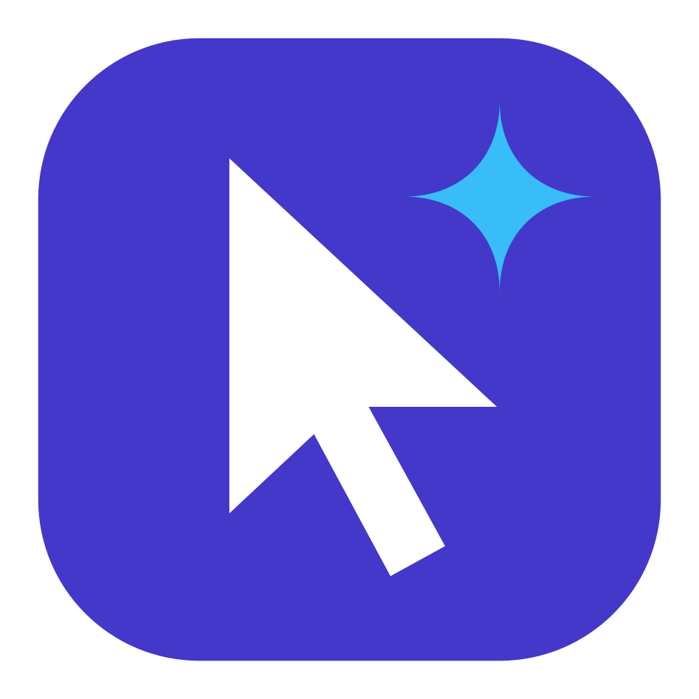

<div align="center">

  

  # Browse Assist

  ### *The Open-Source "PowerToys" for Web Browsing*

  [](package.json)
  [](LICENSE)
  [](https://developer.chrome.com/docs/extensions/mv3/intro/)
  [](https://docs.plasmo.com/)
  [](https://www.typescriptlang.org/)
  [](docs/i18n.md)
  [](#-privacy--permission-transparency)

  <p align="center">
    A lightweight, modular collection of quality-of-life tools designed to elevate your browsing flow.<br />
    Reclaim context menus, navigate with fluid physics, control media effortlessly, and trigger on-screen shortcuts — without slowing down your browser.
  </p>

  <p align="center">
    <a href="https://www.trongajtt.com/apps/browse-assist"><strong>Website</strong></a> •
    <a href="https://www.trongajtt.com/apps/browse-assist/policy"><strong>Privacy Policy</strong></a> •
    <a href="https://www.trongajtt.com/apps/browse-assist/terms"><strong>Terms of Service</strong></a> •
    <a href="docs/features-catalog.md"><strong>Feature Catalog</strong></a> •
    <a href="docs/architecture.md"><strong>Architecture</strong></a>
  </p>

</div>

---

<div align="center">
  
</div>

---

## ⚡ Core Philosophy

Traditional extension suites often inject bloated multi-megabyte frameworks into every tab, draining battery and tracking user telemetry. **Browse Assist** takes the opposite approach inspired by the **Microsoft PowerToys** philosophy:

1. **⚡ Native-Speed & Zero Bloat**: Content scripts remain dormant until invoked by hotkeys or gestures. Lightweight Manifest V3 package (**< 1 MB**).
2. **🛡️ 100% Local-First & Zero Telemetry**: Zero remote servers, zero analytics SDKs, and zero tracking cookies. All user preferences persist strictly inside your browser's sandboxed `chrome.storage.sync` / `chrome.storage.local`.
3. **🧩 Modular Customization**: Turn off any tool you don't need. Reorder popup cards and Quick Hub actions, customize FAB edge placement via right-click or hold-drag, switch between Grid and List views, and choose from **9 languages** (`en`, `vi`, `de`, `es`, `fr`, `ja`, `ko`, `zh_CN`, `zh_TW`).
4. **🔒 Isolated UI (Shadow DOM)**: In-page overlays, toolbars, indicators, and toasts render inside isolated Shadow DOM hosts (`src/core/shadowHost.ts`), preventing CSS conflicts with host websites.

---

## ✨ Features at a Glance

| # | Feature | Trigger / Shortcut | Description |
|---|:---|:---:|:---|
| 1 | **Allow Right Click** | `Alt + R` / Quick Hub | Restores context menus, text selection, and copy operations on restrictive websites that block them. |
| 2 | **Context Menu Actions** | Right-click menu | Smart utilities: **Clean Link on Copy** (2-layer URL cleaner with redirect unwrapping & tracker stripping), **Copy Link Text**, **Markdown Link Copy**, **Copy Clean Page URL**, **Copy Page Markdown**, and **Copy Selection as Quote**. |
| 3 | **Super Drag** | Mouse drag | Drag selected text, links, or images in 4 configurable directions with a redesigned **Circular Radial Indicator** (per-action icons & semantic colors), **Badge Indicator**, and adjustable opacity. |
| 4 | **Smooth Scrolling** | Mouse wheel | Interpolates wheel physics via `requestAnimationFrame`. Presets: *Balanced*, *Ultra*, *Snappy*, and *Custom*, with optional touchpad bypass & keyboard smoothing. |
| 5 | **Universal PiP** | `Alt + P` / Hover Button | Forces any playing HTML5 video into floating Picture-in-Picture mode, with a repositionable floating hover button, customizable opacity, and optional auto-pause on exit. |
| 6 | **Video Wheel Control** | Modifier + Wheel | Hover over video players to adjust **Volume** (with Boost), **Playback Speed**, **Timeline Seeking**, **Fullscreen**, and **Video Screenshot** with a sleek OSD HUD. |
| 7 | **Quick Hub** | Floating Dock / Shortcut | Adaptive Light/Dark glassmorphism launcher for instant access to PiP, Color Picker, Element Toys, Scroll Top/Bottom, Reset Zoom, Clean URL, Allow Right Click, Markdown Copy, and Video Screenshot. |
| 8 | **Quick Scroll Buttons** | Floating Dock / Edge double-click | Floating smart buttons with auto-dim on idle, reading spot memory, opacity control, right-click FAB menu, and auto-hide when native scroll buttons exist. |
| 9 | **Color Picker** | `Alt + Shift + C` / Quick Hub | Magnifier eyedropper zooming into cursor pixels to copy HEX, RGB, or HSL color codes with recent color history (Chromium engines). |
| 10 | **Element Toys** | `Alt + Shift + Z` / Quick Hub | Point-and-click targeting mode: **Zap** (DOM removal with scroll unfreeze), **Edit** (live text), **Move** (Flow/Free reposition & resize), and **Hide**. |
| 11 | **Mouse Pin-to-Zoom** | `Alt` + Wheel | Smoothly zooms in/out of exact page areas centered directly under the cursor. |
| 12 | **Image Hover Preview** | Hover on images / links | Preview `` elements and image links in full size on hover, with entrance animations (*Morph*, *Zoom*, *Fade*, *Slide*, *None*), optional modifier key, delay, and dimensions badge. |
| 13 | **Per-Site Rules & Exclusions** | Shield icon / Quick Hub | Disable all or specific features per domain or `*` wildcard pattern, with live SPA awareness, `Site off` status badges, and quick rule creation from the Popup or Options (`#site-rules`). |

---

## 📸 Screenshots

<div align="center">
  
  
</div>

<div align="center" style="margin-top: 10px;">
  
  
</div>

<div align="center" style="margin-top: 10px;">
  
</div>

---

## 🛠️ Tech Stack & Architecture

- **Core Framework**: [Plasmo Framework](https://docs.plasmo.com/) (Manifest V3)
- **Language**: TypeScript (Strict mode enabled)
- **UI & Styling**: React 18 + Tailwind CSS + Lucide Icons
- **Internationalization**: Rosetta (`rosetta`) across 9 locales
- **Storage Layer**: `@plasmohq/storage` with live cross-context synchronization (`useStorage` & `watch`)
- **Isolation Pattern**: Shadow DOM hosts (`src/core/shadowHost.ts`, `src/core/fab/`) for zero-bleed UI injection
- **Testing**: Vitest + JSDOM
- **Package Manager**: PNPM

### Project Structure

```text
src/
├── components/                  # Shared UI components (Switch, Slider, Modal, Views)
├── core/                        # Storage schemas, type registry, i18n, FAB system, and utilities
│   ├── fab/                     # Shared floating action button context menu & repositioning
│   ├── storage.ts
│   ├── messaging.ts
│   ├── shadowHost.ts
│   ├── linkUtils.ts
│   └── types.ts
├── features/                    # Modular feature implementations (Feature-First)
│   ├── <feature-name>/
│   │   ├── logic.ts             # Content script lifecycle: activate() / deactivate()
│   │   ├── background.ts        # (Optional) Service worker handlers & context menus
│   │   ├── Toggle.tsx           # Switch UI & quick config
│   │   └── SettingsView.tsx     # Dedicated sub-settings view
├── locales/                     # Translations for 9 supported languages
├── background.ts                # Service worker entry point
├── content.ts                   # Content script orchestrator
├── options.tsx                  # Extension options & preferences page
├── popup.tsx                    # Extension popup UI
└── style.css                    # Tailwind tokens & dark/light theme variables
```

---

## ⌨️ Default Keyboard Shortcuts

| Shortcut | Action | Scope |
|---|---|---|
| `Alt + R` | Toggle Allow Right Click | Active Tab |
| `Alt + P` | Toggle Universal Picture-in-Picture | Active Video |
| `Alt + Shift + Z` | Activate Element Toys Toolbar | In-Page Overlay |
| `Alt + Shift + C` | Pick Color from Screen (EyeDropper) | Screen |
| `Shift` + Mouse Wheel | Adjust Video Volume on Hover | Video Element |
| `Alt` + Mouse Wheel | Zoom In/Out Centered at Cursor | Webpage |

> **Note:** All keyboard shortcuts can be customized at any time via your browser's native manager (`chrome://extensions/shortcuts` or `edge://extensions/shortcuts`).

---

## 🛡️ Privacy & Permission Transparency

Browse Assist strictly complies with the **Least Privilege Principle** and the **Chrome Web Store Limited Use Policy**:

| Permission | Real-World Application | External Transmission |
|---|---|:---:|
| `storage` | Stores your preferences, presets, site rules, and toggle states locally. | **0 KB** |
| `activeTab` | Reads the active tab's hostname only when you open the Popup or Site Rules to suggest/apply per-site exclusions. | **None** |
| `contextMenus` / `menus` | Registers clean link and markdown copy options in the right-click menu. | **None** |
| `clipboardWrite` | Writes clean URLs, markdown links, or colors to clipboard **only on click**. | **None** |
| `search` | Triggers default search provider queries when using Super Drag gestures. | **None** |

- **No Remote Tracking:** Browse Assist does **NOT** use Google Analytics, Sentry, Mixpanel, or any tracking beacons.
- **No Sensitive Permissions:** We do **NOT** request `<all_urls>` background tracking permissions, browsing history (`history`), or identity access.

---

## 🚀 Getting Started (Developers)

### Prerequisites

- [Node.js](https://nodejs.org/) (v18.x or v20.x recommended)
- [PNPM](https://pnpm.io/) (v8.x or newer)

### Installation

Clone the repository and install dependencies:

```bash
git clone https://github.com/TrongAJTT/browse-assist.git
cd browse-assist
pnpm install
```

### Development Mode

Run the local development server with hot-reload:

```bash
# Chromium (Chrome, Edge, Brave, Opera)
pnpm dev

# Mozilla Firefox
pnpm dev:firefox
```

1. Open `chrome://extensions` in your browser.
2. Enable **Developer mode** (top-right toggle).
3. Click **Load unpacked** and select the output folder: `build/chrome-mv3-dev`.

### Code Verification

Ensure unit tests, linting, and strict type safety pass:

```bash
# Unit & integration tests
pnpm test

# Linting checks
pnpm lint

# TypeScript verification
pnpm typecheck
```

### Production Packaging

Generate production builds and zipped release packages:

```bash
# Package for Chrome Web Store
pnpm package:chrome

# Package for Firefox Add-ons (AMO)
pnpm package:firefox

# Package for Microsoft Edge Add-ons
pnpm package:edge
```

Production zip archives will be output to `build/<target>-prod.zip`.

---

## 📜 Documentation

- [Detailed Features Catalog](docs/features-catalog.md)
- [Architecture & Design Principles](docs/architecture.md)
- [Internationalization (i18n) Guide](docs/i18n.md)

---

## 💖 Support & Donate

Browse Assist is free, open-source, and contains zero ads or tracking. If it saves you time or improves your daily browsing workflow, you can support ongoing development in any of the following ways:

- ⭐ **Star the repository** on GitHub or share it with friends
- 🐛 **Report bugs or suggest features** via [GitHub Issues](https://github.com/TrongAJTT/browse-assist/issues)
- ☕ **Donate / Sponsor**:

<p>
  <a href="https://buymeacoffee.com/trongajtt"></a>
  <a href="https://github.com/sponsors/TrongAJTT"></a>
  <a href="https://www.trongajtt.com/donate?vietqr=1"></a>
  <a href="https://www.trongajtt.com/sponsor"></a>
</p>

---

## 📄 License

Browse Assist is open-source software licensed under the **Apache License, Version 2.0**.  
See the [LICENSE](LICENSE) file for the full license text.

```text
Copyright 2026 TrongAJTT

Licensed under the Apache License, Version 2.0 (the "License");
you may not use this file except in compliance with the License.
You may obtain a copy of the License at

    http://www.apache.org/licenses/LICENSE-2.0
```

---

<div align="center">
  <sub>Designed with ❤️ by <a href="https://github.com/TrongAJTT">TrongAJTT</a>. "PowerToys" is an inspirational homage to modular utility design.</sub>
</div>
