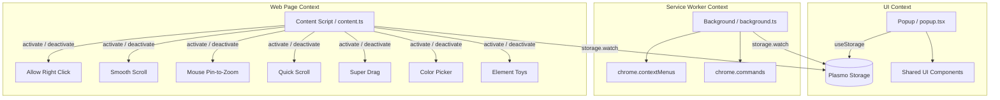

# Browse Assist — Architecture & Design Guide

This document provides a comprehensive overview of the system architecture of Browse Assist, the bi-directional data flow between Manifest V3 contexts, and the UI design philosophy.

---

## 1. System Layer Architecture

Browse Assist is built on the **Plasmo Framework (Manifest V3)**, structured across three completely isolated execution contexts:



### Context Isolation Principles:
1. **Popup UI (`src/popup.tsx`)**:
   - Executes when the user clicks the extension toolbar icon.
   - Must never interact directly with the web page DOM (no DOM calls targeted at web tabs).
   - Reads and writes persistent configurations exclusively via `@plasmohq/storage/hook` (`useStorage`).
2. **Background Service Worker (`src/background.ts`)**:
   - Headless context without a DOM (`window` and `document` do not exist).
   - Responsible for registering Context Menus, listening to global hotkeys (`chrome.commands`), and handling tab operations (e.g. background search tabs).
3. **Content Script (`src/content.ts`)**:
   - Injected into web pages.
   - **Never import React/JSX components or hooks**. Only import pure modular logic from `src/features/*/logic.ts`.
   - Subscribes to storage changes to immediately call `activate()` or clean up all event listeners with `deactivate()` without requiring a page reload.

---

## 2. Two-Tier State Management

### Tier 1: Persistent Single Source of Truth (`@plasmohq/storage`)
- **Default Storage Key**: `"browse_assist_settings"` (defined in `src/core/types.ts`).
- Setting mutations from the popup automatically sync across to Content Scripts and the Service Worker in real time without manual `chrome.runtime.sendMessage` boilerplate.

### Tier 2: Local Ephemeral State (`useState` / `useReducer`)
- Dedicated to transient UI state:
  - Active popup tab selection.
  - In-popup feature search queries.
  - Hover states, tooltips, and toast notifications.
  - Expand/collapse animation state for feature settings cards.

---

## 3. Feature Lifecycle Contract

Every content-script module (`src/features/<feature>/logic.ts`) must implement the standard contract:

```typescript
export function activate(): void {
  // Attach event listeners, inject temporary styling
}

export function deactivate(): void {
  // Remove all event listeners, remove injected overlays/styles
}
```

This prevents memory leaks, duplicate event triggers, and unintended behavior when users toggle features on/off live.
